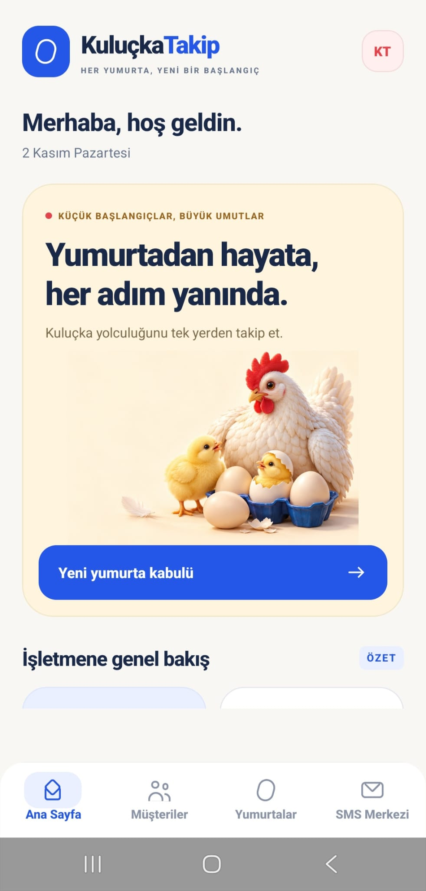
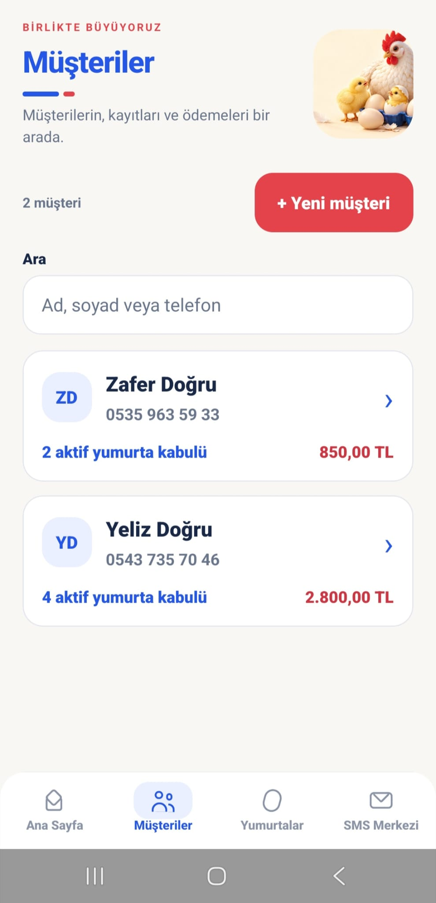
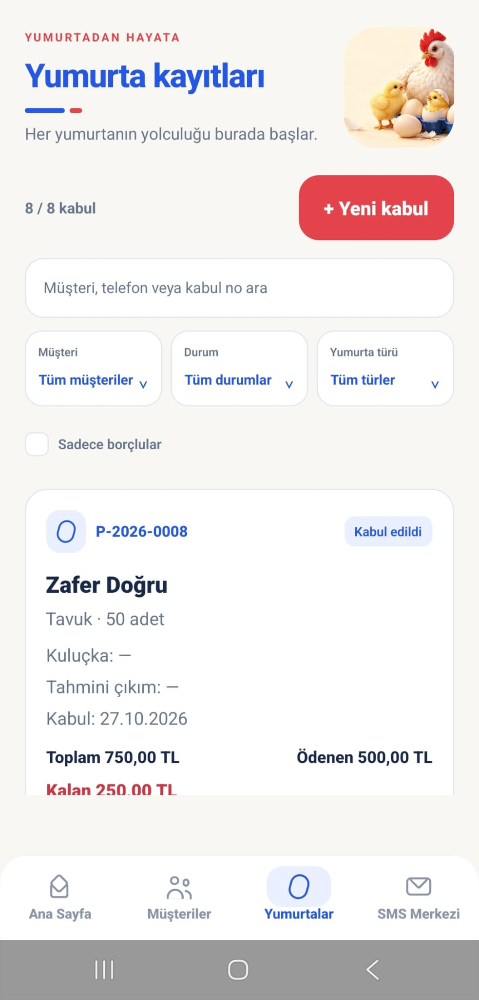
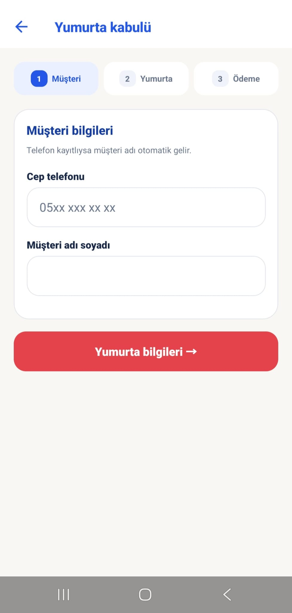
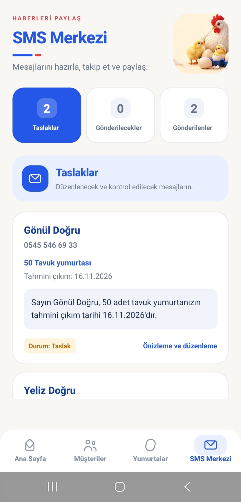

# Kuluçka Takip

Kuluçka işletmeleri için geliştirilen Android uygulaması. Müşteri kayıtlarını, yumurta kabullerini, ödemeleri ve SMS bildirimlerini tek yerden takip etmeyi sağlar.

**Sürüm:** 1.1.7 · **Platform:** Android 7+ · **Teknolojiler:** Expo SDK 57, React Native, TypeScript, Supabase

## Özellikler

- **Ana sayfa:** İşletmenin güncel durumunu özetleyen göstergeler.
- **Müşteri takibi:** Müşteri oluşturma, iletişim bilgileri, kabul geçmişi ve ödeme kayıtları.
- **Yumurta kabulü:** Kabul oluşturma, düzenleme ve onayla silme; kuluçka sürecini ve çıkım tarihlerini takip etme. Yumurta türleri yönetilebilir.
- **Arama ve filtreleme:** Müşteri, telefon, kabul numarası ve yumurta türüyle arama; müşteri, durum, tür ve borç filtrelerini birlikte kullanma.
- **Ödeme takibi:** Kabul kayıtlarına ödeme ekleme ve kalan borcu görüntüleme.
- **SMS merkezi:** Ödeme bilgili taslakları inceleme, düzenleme, silme ve Android telefonun SIM hattından doğrudan gönderme. Sonucu belirsiz mesajların tekrar gönderimi onay gerektirir.
- **Ortak işletme kayıtları:** Yetkili kullanıcıların aynı Supabase verilerine farklı telefonlardan erişmesi.

## Ekran görüntüleri

<table>
  <tr>
    <th>Ana sayfa</th>
    <th>Müşteriler</th>
    <th>Yumurta kayıtları</th>
  </tr>
  <tr>
    <td></td>
    <td></td>
    <td></td>
  </tr>
  <tr>
    <th>Yeni yumurta kabulü</th>
    <th>SMS merkezi</th>
    <th></th>
  </tr>
  <tr>
    <td></td>
    <td></td>
    <td></td>
  </tr>
</table>

## 1.1.7 ile gelenler

Uygulama simgesi ana sayfadaki tavuk ve civciv görseliyle güncellendi. SMS taslaklarına ödenen ve kalan tutar eklendi; önizlemeden doğrudan gönderim ve taslak silme sağlandı. Kabul silme, kabul tarihi ve fiyat düzenleme, yumurta türü yönetimi ve liste yükleme iyileştirmeleri eklendi. Tavuk yeni kabullerde varsayılan türdür.

Bu değişiklikler için `20261120120000` ile `20261120170000` arasındaki migration dosyaları sırayla uygulanmalıdır. APK dosyaları `output/releases` altında yerel olarak üretilir ve Git deposuna eklenmez.

## 1.1.4 ile gelenler

Redmi/MIUI telefonlarda SMS desteğinin yanlışlıkla “modül eksik” olarak algılanması düzeltildi. SMS Merkezi cihaz desteğini ayrıca gösterir. Ayrıntılar: [1.1.4 sürüm notları](docs/UPDATE_1.1.4.md).

## 1.1.3 ile gelenler

Telefon alanının klavye altında kalması düzeltildi; SMS son satırına Yalınayak Süs Tavukları 🐔 imzası eklendi. Kayıt/ödeme tekrar denemeleri, ödeme düzeltme/iptali ve müşteri/SMS tutarlılığı iyileştirildi. Sunucu migration’ları uygulandı; her iki imza serisinde APK üretildi. Ayrıntılar: [1.1.3 sürüm notları](docs/UPDATE_1.1.3.md).

## 1.1.2 ile gelenler

Yumurta kayıtlarında birleşik filtreler, Türkçe karakterleri destekleyen arama ve aranabilir seçim listeleri eklendi. Filtre seçimleri ekran yenilenirken ve kayıt detayından dönülürken korunur. Ayrıntılar: [1.1.2 sürüm notları](docs/UPDATE_1.1.2.md).

## Yeni telefona kurulum

1. `output/releases/KuluckaTakip-1.1.7.apk` dosyasını Android telefona aktarın ve açın.
2. Telefon isterse dosyayı açan uygulamaya bu kaynaktan kurulum izni verin.
3. İnternet bağlantısıyla yetkili hesabınızla giriş yapın. Diğer telefonlarla aynı işletme kayıtları Supabase üzerinden kullanılır.
4. SMS izni yalnız gerçekten mesaj göndermek istediğinizde istenir. SIM ve varsayılan SMS hattı gerekir; kayıtları görüntülemek için SMS izni gerekmez.

Uygulama bilgisayar, Metro veya Expo Go bağlantısı olmadan çalışır. Sunucu kayıtları için internet gerekir; çevrimdışı kayıt ve senkronizasyon kuyruğu yoktur. Paket Android 7 ve üzeri ARM 32/64 bit telefonlar içindir; iPhone kurulum paketi değildir.

Daha önce geliştirme sürümü yüklenmiş telefonlarda `KuluckaTakip-1.1.7-mevcut-telefon-guncelleme.apk` dosyası kullanılır. Bu paket mevcut imzayı korur. Yeni dağıtım anahtarıyla imzalanan standart APK eski geliştirme imzasının üzerine kurulamaz; mevcut uygulamayı ve verilerini silmeyin. Sonraki güncellemelerde her telefon için aynı imza serisi kullanılmalıdır.

## Hesap ve sunucu

`.env.example` örneğiyle `.env` oluşturun. Yalnız proje URL'si ve **public anon/publishable** anahtar kullanılmalıdır; service-role/secret anahtarlar mobil uygulamaya konmaz.

Migration'ların asıl dizini `supabase/migrations` dizinidir. `database/migrations` mevcut SQL Editor kurulumları için eşlenmiş kopyadır. Migration sırası korunmalıdır; yalnız ilk şemayı uygulamak yeterli değildir. Dağıtım için üyelik, SMS claim/içerik doğrulama, birleşik SMS listesi ve ana sayfa özet fonksiyonlarının da sunucuda bulunması gerekir.

Kullanıcılar Supabase Authentication üzerinden yönetici tarafından oluşturulur; uygulamada herkese açık kayıt yoktur. Yönetici, giriş yapacak kullanıcının Auth UUID'sini `public.app_members` tablosuna `active=true` olarak ekler. Yetkili hesaplar aynı işletme verilerini paylaşır. Çıkış yalnız kullanılan telefonun oturumunu kapatır. Supabase Auth ayarlarında eşzamanlı oturumların kısıtlanmadığı kontrol edilmelidir.

## Geliştirme ve kontroller

Node.js 22.13 veya üstü, Java 17 ve Android SDK gerekir.

```powershell
npm ci
npm run check
npm run start
```

Gerçek SIM gönderimi özel `modules/sim-sms` modülünü içerir; Expo Go ile gerçek SMS testi yapılamaz. Android geliştirme paketi için `npm run android` kullanın. Sunucu ayarları eksikse yalnız geliştirmede demo ekranları açılır; release paketi eksik ayarlarla demo veriye yazmaz.

## Dağıtım paketi üretme

```powershell
npm run build:android
# Eski geliştirme sertifikasıyla kurulmuş telefonları veri silmeden güncellemek için:
powershell -NoProfile -ExecutionPolicy Bypass -File scripts/build-android.ps1 -LegacyUpdate
```

Komut sunucu ayarlarını, TypeScript'i ve testleri kontrol eder; Hermes içeren release APK'sını ARM 32/64 bit için derler. APK ve SHA-256 özeti `output/releases` dizinine yazılır. İlk çalışmada kalıcı dağıtım anahtarı `.signing` dizininde oluşturulur. **Bu dizini özel ve güvenli bir yerde yedekleyin; sonraki sürümleri aynı anahtarla imzalamak gerekir.** Anahtar ve parolalar Git'e veya APK paylaşım klasörüne dahil edilmez.

`app.json`, `package.json` ve `android/app/build.gradle` sürümleri birlikte artırılır; her dağıtımda Android `versionCode` büyütülür. `eas.json` bulut build profilleri ayrıca hesap/kimlik bilgisi kurulumu gerektirir; burada doğrulanan dağıtım yerel PowerShell akışıdır.

## İnceleme

- [Mimari](docs/ARCHITECTURE.md)
- [Veritabanı](docs/DATABASE.md)
- [Tasarım](docs/DESIGN.md)
- [Performans incelemesi](docs/PERFORMANCE_REVIEW.md)
- [Dağıtım ve doğrulama kapsamı](docs/RELEASE_REVIEW.md)
- [1.1.1 sürüm notları](docs/UPDATE_1.1.1.md)
- [1.1.2 sürüm notları](docs/UPDATE_1.1.2.md)

## Lisans

Lisans koşulları için [LICENSE](LICENSE) dosyasına bakın.


## Hazırlanan akış düzeltmeleri — 5 Kasım 2026

Kabul/ödeme tekrar denemeleri, tarih ve SMS tutarlılığı, ödeme düzeltme/iptali ve arşivden geri alma 1.1.3 sürümüne alındı. İlgili sunucu migration’ları uygulandı; 1.1.3 APK’ları bu değişiklikleri içerir. [Düzeltmeler, kontroller ve geçiş sırası](docs/FLOW_FIXES_2026-11-05.md).
